 

## Hi, I'm li4

**DevOps Engineer · Python Developer**

&nbsp;&nbsp;

---

### About

| | |
|---|---|
| **Role** | DevOps Engineer & Python Developer |
| **Focus** | Infrastructure, automation, tooling |
| **Core stack** | Python · Linux · Docker · Bash · CI/CD |

---

### Achievements

-  &nbsp;**Quickdraw** — closed an issue in under 5 minutes
-  &nbsp;**YOLO** — merged a pull request without review

---

### Find me

- GitHub — [@the-li4](https://github.com/the-li4)

---

Built with <code>gh</code> &amp; <code>git</code> · <a href="https://github.com/the-li4/the-li4/issues">Issues</a> · <a href="https://github.com/the-li4/the-li4/pulls">Pull requests</a>

