 

## Hi, I'm li4

**Cybersecurity · DevOps Engineering · Python**

&nbsp;&nbsp;

 

 &nbsp;**Security**
&nbsp;&nbsp;&nbsp;
 &nbsp;**DevOps**
&nbsp;&nbsp;&nbsp;
 &nbsp;**Python**

---

### What I do

| | |
|---|---|
| **Security** | Threat intel, hardening, network defence, vulnerability assessment |
| **DevOps** | CI/CD, containers, infrastructure as code, automation |
| **Tooling** | Python for automation, scripting and tooling |

---

### Achievements

-  &nbsp;**Quickdraw** — closed an issue in under 5 minutes
-  &nbsp;**YOLO** — merged a pull request without review

---

### Find me

- GitHub — [@the-li4](https://github.com/the-li4)

---

Built with <code>gh</code> &amp; <code>git</code> · <a href="https://github.com/the-li4/the-li4/issues">Issues</a> · <a href="https://github.com/the-li4/the-li4/pulls">Pull requests</a>

